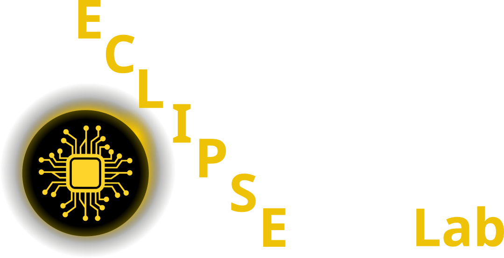

:::: {.columns}

::: {.column width="50%"}
[{width=300}](https://pelzlab.science)
:::

::: {.column width="25%"}
[{width=120}](https://github.com/ECLIPSE-Lab/MachineLearningForMicroscopy)

**Github Code**
:::

::: {.column width="25%"}
[{width=120}](https://www.studon.fau.de/studon/ilias.php?baseClass=ilrepositorygui&cmd=infoScreenGoto&ref_id=7067079)

**Studon Link**
:::

::::

[Pelz Lab website](https://pelzlab.science)

## Course overview

The seminar meets on Wednesdays, 16:00–17:30, in IZNF room 01.140.
The first session is on 28.10.2026.
There is no session on 21.10.2026, 23.12.2026, 30.12.2026 and 06.01.2027.

Slides, the topic sign-up and the forum are on StudOn.

**Prerequisite:** the lecture [Data Science for Electron Microscopy](https://pelzlab.science/DataScienceForElectronMicroscopy/) is highly recommended.

## Requirements

- Give one 30-minute seminar talk on a chosen topic. The talk is graded.
- Attend all journal club meetings and at least 4 seminar talk meetings.
- Present in the journal club meetings. These presentations are casual and not graded.
- The seminar has 2 ECTS, which is about 60 hours of work.

**Journal club.** In 5 journal club meetings, we study and discuss the papers that lead up to the seminar topics.
Go through a paper and explain it in your own words, in a casual style ([example](https://www.youtube.com/watch?v=CRlN-cYFxTk)).
The journal club is your practice for the seminar talk.

**Grading of the seminar talk:**

| Criterion | Weight | What counts |
|---|---|---|
| Visualization | 30% | One message per slide, large text, figures instead of bullet lists |
| Know your audience | 30% | The audience is not expert researchers: explain the underlying concepts |
| Timing | 10% | Stay within ±2 minutes of 30 minutes |
| Fluency and logic | 30% | A clear story from motivation to summary |

A talk that is more than 2 minutes too long or too short loses 0.3 grade points; more than 4 minutes loses 0.6.

## Schedule

| Date | Session | Homework |
|---|---|---|
| 28.10.2026 | Info & topics | Book a topic on StudOn by 03.11.2026 |
| 04.11.2026 | Journal club 1 | |
| 11.11.2026 | Journal club 2 | |
| 18.11.2026 | Journal club 3 | |
| 25.11.2026 | Journal club 4 | |
| 02.12.2026 | Journal club 5 | |
| 09.12.2026 | Seminar talks 1 + 2 | |
| 16.12.2026 | Seminar talks 3 + 4 | |
| 23.12.2026 – 06.01.2027 | Winter break, no session | |
| 13.01.2027 | Seminar talks 5 + 6 | |
| 20.01.2027 | Seminar talks 7 + 8 | |
| 27.01.2027 | Seminar talks 9 + 10 | |
| 03.02.2027 | Buffer | |

## Topics

Each topic has one or two papers. Book your topic on StudOn; each topic can be taken once.

1. **Convolutional neural networks for segmentation**
   - Rangel DaCosta, L. et al. (2024). A robust synthetic data generation framework for machine learning in high-resolution transmission electron microscopy (HRTEM). *npj Computational Materials* 10, 1–11. [doi:10.1038/s41524-024-01336-0](https://doi.org/10.1038/s41524-024-01336-0)
   - Sytwu, K., Groschner, C. & Scott, M. C. (2022). Understanding the influence of receptive field and network complexity in neural network-guided TEM image analysis. *Microscopy and Microanalysis* 28, 1896–1904. [doi:10.1017/S1431927622012466](https://doi.org/10.1017/S1431927622012466)
2. **CNNs and rotationally invariant VAEs: deep Bayesian local crystallography**
   - Kalinin, S. V. et al. (2021). Deep Bayesian local crystallography. *npj Computational Materials* 7, 1–12. [doi:10.1038/s41524-021-00621-6](https://doi.org/10.1038/s41524-021-00621-6)
3. **CNNs in tomographic image reconstruction**
   - Wu, Z. et al. (2023). Three-dimensional nanoscale reduced-angle ptycho-tomographic imaging with deep learning (RAPID). *eLight* 3, 7. [doi:10.1186/s43593-022-00037-9](https://doi.org/10.1186/s43593-022-00037-9)
   - Wu, Z. et al. (2020). Deep learning-based low-dose tomography reconstruction with hybrid-dose measurements. *IEEE/ACM AI4S Workshop*, 88–95. [doi:10.1109/MLHPCAI4S51975.2020.00017](https://doi.org/10.1109/MLHPCAI4S51975.2020.00017)
4. **CNNs for denoising: DivNoising**
   - Prakash, M., Krull, A. & Jug, F. (2020). DivNoising: diversity denoising with fully convolutional variational autoencoders. [arXiv:2006.06072](http://arxiv.org/abs/2006.06072)
5. **Untrained neural networks for denoising**
   - Heckel, R. & Hand, P. (2019). Deep Decoder: concise image representations from untrained non-convolutional networks. [arXiv:1810.03982](http://arxiv.org/abs/1810.03982)
   - Heckel, R. & Soltanolkotabi, M. Denoising and regularization via exploiting the structural bias of convolutional generators. *ICLR*. [openreview](https://openreview.net/forum?id=HJeqhA4YDS)
6. **Untrained and physics-based neural networks**
   - Bostan, E. et al. (2020). Deep phase decoder: self-calibrating phase microscopy with an untrained deep neural network. *Optica* 7, 559–562. [doi:10.1364/OPTICA.389314](https://doi.org/10.1364/OPTICA.389314)
   - Monakhova, K. et al. (2021). Untrained networks for compressive lensless photography. *Optics Express* 29, 20913–20929. [doi:10.1364/OE.424075](https://doi.org/10.1364/OE.424075)
7. **Implicit neural representations**
   - Mildenhall, B. et al. (2020). NeRF: representing scenes as neural radiance fields for view synthesis. [arXiv:2003.08934](http://arxiv.org/abs/2003.08934)
   - Kerbl, B. et al. (2023). 3D Gaussian splatting for real-time radiance field rendering. *SIGGRAPH 2023*. [project page](https://repo-sam.inria.fr/fungraph/3d-gaussian-splatting/)
8. **Transformers in image reconstruction**
   - Liang, J. et al. (2021). SwinIR: image restoration using Swin Transformer. [doi:10.48550/arXiv.2108.10257](https://doi.org/10.48550/arXiv.2108.10257)
   - Liu, Z. et al. (2021). Swin Transformer: hierarchical vision transformer using shifted windows. *ICCV 2021*, 10012–10022. [paper](https://openaccess.thecvf.com/content/ICCV2021/html/Liu_Swin_Transformer_Hierarchical_Vision_Transformer_Using_Shifted_Windows_ICCV_2021_paper.html)
9. **Physics-based neural networks for atomic electron tomography**
   - Ren, D., Ophus, C., Chen, M. & Waller, L. (2020). A multiple scattering algorithm for three dimensional phase contrast atomic electron tomography. *Ultramicroscopy* 208, 112860. [doi:10.1016/j.ultramic.2019.112860](https://doi.org/10.1016/j.ultramic.2019.112860)
10. **Diffusion models for image reconstruction**
    - Chung, H. et al. (2022). Diffusion posterior sampling for general noisy inverse problems. [doi:10.48550/arXiv.2209.14687](https://doi.org/10.48550/arXiv.2209.14687)
    - Liu, J. et al. (2022). DOLCE: a model-based probabilistic diffusion framework for limited-angle CT reconstruction. [doi:10.48550/arXiv.2211.12340](https://doi.org/10.48550/arXiv.2211.12340)
11. **Atomic-resolution coherent X-ray imaging with physics-based phase retrieval**
    - Meziere, J. et al. (2024). Atomic resolution coherent x-ray imaging with physics-based phase retrieval. *npj Computational Materials* 10, 1–11. [doi:10.1038/s41524-024-01340-4](https://doi.org/10.1038/s41524-024-01340-4)
12. **Unsupervised deep denoising for 4D-STEM**
    - Sadri, A. et al. (2024). Unsupervised deep denoising for four-dimensional scanning transmission electron microscopy. *npj Computational Materials* 10, 1–13. [doi:10.1038/s41524-024-01428-x](https://doi.org/10.1038/s41524-024-01428-x)
13. **Few-shot and zero-shot segmentation**
    - Akers, S. et al. (2021). Rapid and flexible segmentation of electron microscopy data using few-shot machine learning. *npj Computational Materials* 7, 1–9. [doi:10.1038/s41524-021-00652-z](https://doi.org/10.1038/s41524-021-00652-z)
    - Abebe, W. et al. (2025). SAM-I-Am: semantic boosting for zero-shot atomic-scale electron micrograph segmentation. *Computational Materials Science* 246, 113400. [doi:10.1016/j.commatsci.2024.113400](https://doi.org/10.1016/j.commatsci.2024.113400)

## Archive

The SS 25 version of this seminar had the same format: an intro session, journal clubs, then seminar talks.
